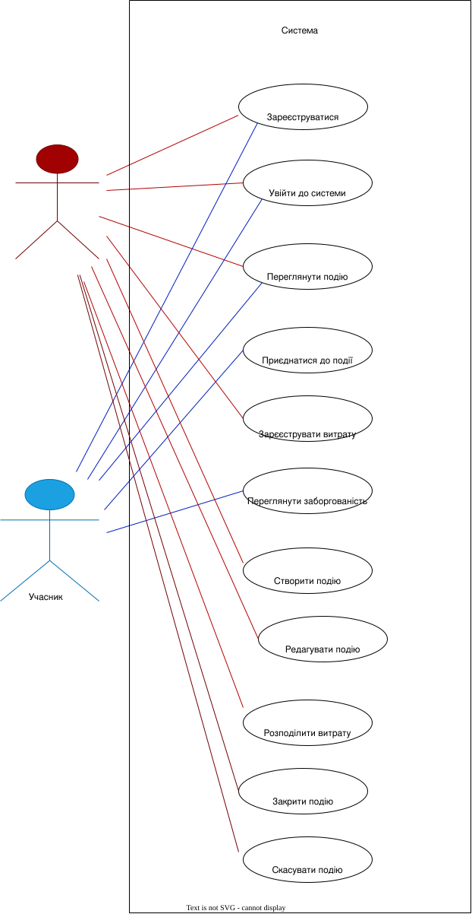

# Проєктування версії v1.0

## Use-case діаграма

Діаграма відповідає на питання: хто взаємодіє із системою у межах v1.0 і яких цілей досягає. На ній потрібно побачити межу системи «Система організації подій», двох акторів і дев'ять варіантів використання.

Пов'язані вимоги: FR-01…FR-12.

**Актори.** Учасник виконує базові дії: реєстрація, вхід, перегляд події, приєднання, реєстрація витрат і перегляд балансу. Організатор є узагальненням Учасника: він виконує все те саме, а також створює й редагує подію та розподіляє витрати.

| Use Case | Актор | Вимоги |
|---|---|---|
| UC-01 Зареєструватися | Учасник/Організатор | FR-01, FR-02 |
| UC-02 Увійти до системи | Учасник/Організатор | FR-01, FR-02 |
| UC-03 Переглянути подію | Учасник/Організатор | FR-05, FR-08 |
| UC-04 Приєднатися до події | Учасник | FR-07, FR-15 |
| UC-05 Зареєструвати витрату | Організатор | FR-09, FR-10, FR-15 |
| UC-06 Переглянути баланс | Учасник/Організатор | FR-12 |
| UC-07 Створити подію | Організатор | FR-03, FR-04 |
| UC-08 Редагувати подію | Організатор | FR-04, FR-06, FR-15 |
| UC-09 Розподілити витрату | Організатор | FR-11, FR-15 |
| UC-10 Закрити подію | Організатор | FR-13 |
| UC-11 Скасувати подію | Організатор | FR-14 |

## Activity Diagram

Activity Diagram деталізує перебіг сценарію: послідовність дій, точки рішення та альтернативні завершення. Кожен учасник команди побудував діаграму для свого Use Case. Код діаграм у форматі Mermaid зберігається в каталозі `model/` і версіонується разом з документацією.

| Use Case | Що показує діаграма | Вимоги | Діаграма |
|---|---|---|---|
| UC-02 Увійти до системи | Перевірку полів і перевірку облікових даних, два помилкові завершення | FR-01, FR-02 | [activity-uc-02.md](../model/activity-uc-02.md) |
| UC-05 Зареєструвати витрату | Перевірку суми та скасування дії | FR-09, FR-10 | [activity-uc-05.md](../model/activity-uc-05.md) |
| UC-07 Створити подію | Послідовну перевірку назви та дати | FR-03, FR-04 | [activity-uc-07.md](../model/activity-uc-07.md) |
| UC-09 Розподілити витрату | Перевірку вибору учасників і суми часток | FR-11, NFR-02 | [activity-uc-09.md](../model/activity-uc-09.md) |

## Діаграма класів

Діаграма відповідає на питання: які предметні сутності потрібні для v1.0 і як вони пов'язані. На ній потрібно побачити, що роль користувача (Організатор чи Учасник) зберігається в класі `Participation`, а не в `User`, що витрата розподіляється на частки та що подія має стан, від якого залежить дозволена поведінка.

Пов'язані вимоги: FR-01, FR-03, FR-07–FR-15, NFR-02, NFR-05.

### Пояснення сутностей

- **User** — зареєстрований користувач (FR-01, FR-02). Пароль зберігається лише як хеш (NFR-05).
- **Event** — подія з назвою, датою, місцем, описом і станом (FR-03–FR-06, FR-13, FR-14). `InviteCode` потрібен для посилання-запрошення (FR-07). Атрибут `Status` має тип `EventStatus`; операції `Close()` і `Cancel()` переводять подію зі стану «Створена» у стан «Закрита» або «Скасована».
- **Participation** — участь користувача в конкретній події. Тут зберігається роль, бо один користувач може бути Організатором в одній події та Учасником в іншій. Створювач події отримує роль `Organizer` (FR-03, FR-08).
- **Expense** — спільна витрата: сума, опис і платник (FR-09, FR-10).
- **ExpenseShare** — частка однієї витрати, що припадає на одного учасника (FR-11).
- **ParticipantRole** — перелік ролей: `Organizer`, `Participant`.
- **EventStatus** — перелік станів події: `Created`, `Closed`, `Cancelled` (див. State Machine Diagram).
- **Баланси** (FR-12) окремо не зберігаються. `Event.GetBalances()` обчислює їх як «сплачено мінус сума власних часток».

Терміни SRS і Use Case відповідають моделі так: «Учасник» — це `Participation` із будь-якою роллю, «Організатор» — `Participation` з `Role = Organizer`.

### Типи зв'язків

- **Композиція** (чорний ромб): `Event` ◆ `Participation`, `Event` ◆ `Expense`, `Expense` ◆ `ExpenseShare`. Частина не існує без цілого: видалення події видаляє її учасників і витрати, видалення витрати видаляє її частки.
- **Асоціація**: `User` — `Participation`, `Expense` → `Participation` (платник), `ExpenseShare` → `Participation` (учасник, що має частку). Об'єкти пов'язані, але живуть незалежно.
- **Залежність** (пунктир): `Event` ⇢ `EventStatus`, `Participation` ⇢ `ParticipantRole` — використання переліку як типу атрибута.
- Узагальнення та агрегація не використовуються: роль зроблено атрибутом, а не підкласами.

### Кратності

- Користувач може мати 0..* участей (у різних подіях).
- Подія має 1..* учасників: щонайменше Організатора.
- Подія має 0..* витрат.
- Витрата має рівно одного платника.
- Витрата має 0..* часток: до розподілу (UC-09) часток немає, після нього щонайменше одна.

### Обмеження, які діаграма не показує

- Пара (User, Event) унікальна: користувач не може приєднатися до однієї події двічі.
- У кожній події рівно один Організатор.
- Платник витрати та всі учасники часток належать тій самій події, що й витрата.
- Сума `ExpenseShare.Amount` по витраті дорівнює `Expense.Amount` з точністю до 0,01 грн (AC-11, NFR-02).
- Нова подія має стан `Created`. Переходи `Created → Closed` і `Created → Cancelled` виконує лише Організатор, зворотних переходів немає (FR-13, FR-14).
- Редагування події, приєднання, реєстрація й розподіл витрат дозволені лише для події у стані `Created` (FR-15).
  
## State Machine Diagram

У v1.0 State Machine Diagram доречна для об'єкта Event, оскільки дозволені дії залежать від його стану. Після створення подія перебуває у стані «Створена»: у ньому Організатор може редагувати подію, приєднувати учасників, реєструвати й розподіляти витрати. Після закриття або скасування події ці дії виконувати не можна, залишається лише перегляд. Отже, стан є не просто довідковим атрибутом, а частиною предметних правил.

На діаграмі показано три змістовні стани Event: «Створена», «Закрита» і «Скасована». Перехід до стану «Закрита» відбувається після закриття події Організатором (UC-10, FR-13), а перехід до стану «Скасована» після її скасування (UC-11, FR-14). Редагування події, приєднання учасників, реєстрація та розподіл витрат дозволені лише для Event у стані «Створена» (FR-15). Повернення зі станів «Закрита» і «Скасована» у v1.0 не передбачено.

