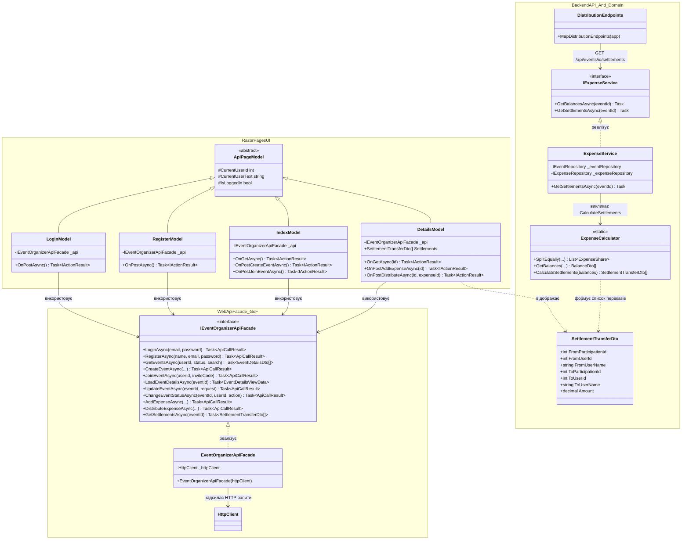

# Модель фактичної реалізації (Спринт 3 / v2.0.0)

## 1. Усунення дублювання HTTP-логіки шаблоном GoF «Фасад»

У попередніх версіях класи сторінок веб-клієнта містили `code smell` — пряме створення `HttpClient` у понад 15 місцях, дублювання формування URL/query-параметрів і ручний розбір `JsonElement` / кодів помилок API.

Під час рефакторингу у Спринті 3 застосовано структурний шаблон проєктування GoF **«Фасад»**:
* Виокремлено єдиний клієнтський інтерфейс **`IEventOrganizerApiFacade`** та його реалізацію **`EventOrganizerApiFacade(HttpClient)`** у просторі імен `EventOrganizer.Api.Pages.ApiFacade`.
* Сторінки Razor Pages більше не залежать від `HttpClient` і деталей серіалізації JSON — кожна сторінка делегує роботу з REST API одному методу фасаду.
* Передача `HttpClient` через конструктор фасаду дозволила покрити всю взаємодію з API захисними тестами (`WebApiFacadeTests`) із використанням тестового двійника `FakeHttpHandler` без запуску вебсервера.
* Поверх оновленої архітектури додано нову користувацьку операцію **`US-04` / `UC-12` «План взаєморозрахунків»** (`GET /api/events/{eventId}/settlements` → `IEventOrganizerApiFacade.GetSettlementsAsync`), яка обчислює мінімальний набір переказів між учасниками без зміни схеми бази даних.

---

## 2. Діаграма класів фактичної реалізації (Mermaid)

---

## 3. Відповідність елементів моделі файлам коду

| Компонент моделі | Шлях у репозиторії (`src/EventOrganizer.Api`) | Роль у системі |
|---|---|---|
| `IEventOrganizerApiFacade` | `Pages/ApiFacade/IEventOrganizerApiFacade.cs` | Контракт фасаду (шаблон GoF `Facade`) для всіх сторінок веб-клієнта |
| `EventOrganizerApiFacade` | `Pages/ApiFacade/EventOrganizerApiFacade.cs` | Інкапсуляція `HttpClient`, маршрутів `/api/...`, query-рядків та розбору JSON-відповідей і помилок |
| `ApiCallResult` / DTO клієнта | `Pages/ApiFacade/ApiCallResult.cs` | Моделі результатів викликів фасаду (`LoginResult`, `EventDetailsViewData`, `EventParticipantItem`) |
| `LoginModel`, `RegisterModel`, `IndexModel`, `DetailsModel` | `Pages/Account/*.cshtml.cs`, `Pages/Index.cshtml.cs`, `Pages/Events/Details.cshtml.cs` | UI-логіка Razor Pages, очищена від прямих викликів `HttpClient` |
| `DistributionEndpoints` | `Endpoints/DistributionEndpoints.cs` | Мінімальний ендпоінт `GET /api/events/{eventId:int}/settlements` |
| `ExpenseService` | `Services/Implementations/ExpenseService.cs` | Координація перевірки події, отримання балансів та розрахунку переказів (`GetSettlementsAsync`) |
| `ExpenseCalculator` | `Services/ExpenseCalculator.cs` | Чиста функція `CalculateSettlements` жадібного зведення боргів і кредитів із точністю до `0,01 грн` |
| `SettlementTransferDto` | `Contracts/SettlementTransferDto.cs` | Контракт одного переказу між боржником і кредитором |
