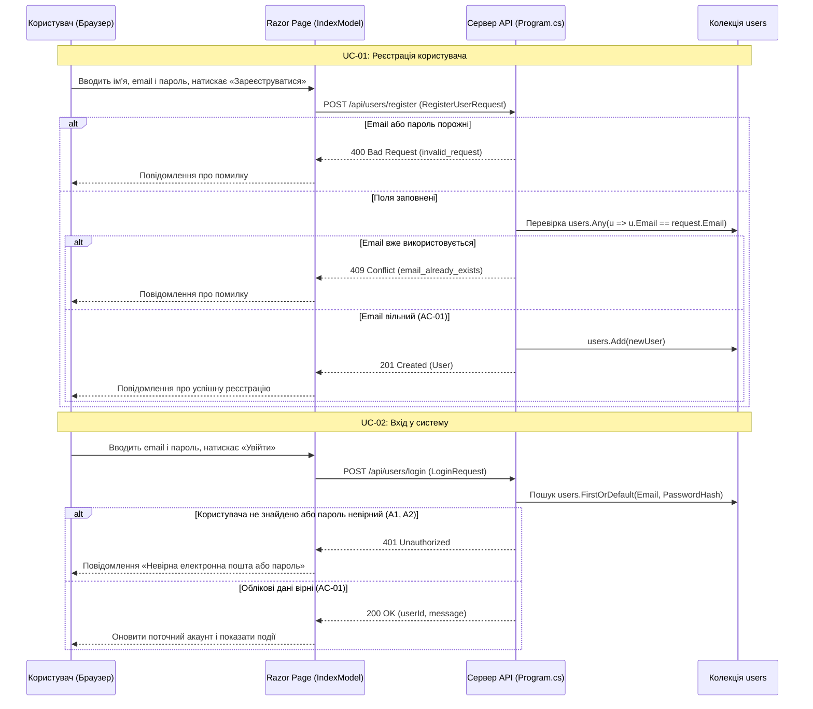

# Діаграма послідовності UC-01 «Зареєструватися» та UC-02 «Увійти до системи»

Діаграма де клієнтська частина — Razor Page `Pages/Index.cshtml` (`IndexModel.OnPostRegisterAsync`, `IndexModel.OnPostLoginAsync`), серверна частина — маршрути `POST /api/users/register` та `POST /api/users/login` у `Program.cs` і колекція `users` у пам'яті.

