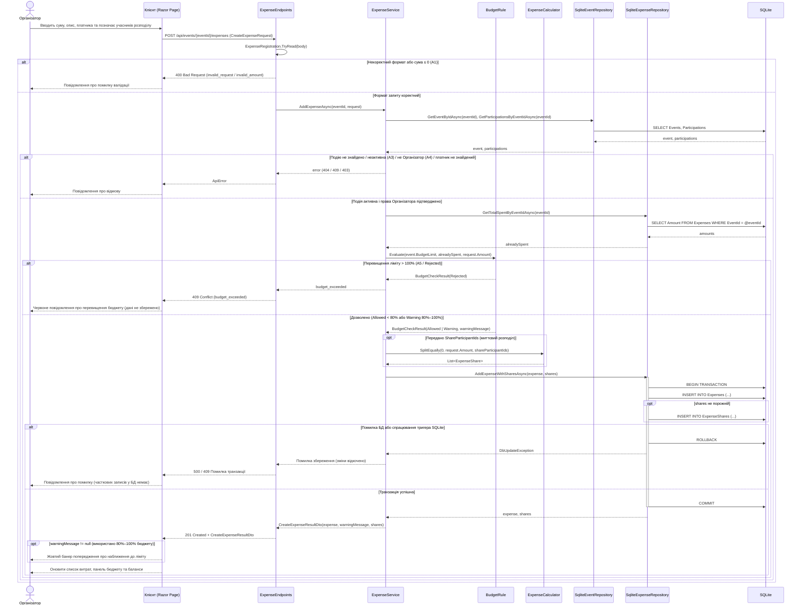

# Діаграма послідовності UC-05 «Зареєструвати витрату» (Спринт 2 / US-03)

**Базовий автор:** Анастасія Халаминдик (@ansstassya)  
**Актуалізація під архітектуру Спринту 2:** Марія Ткаченко  

Діаграма відображає фактичний потік викликів у багатошаровій архітектурі `EventOrganizer` (Спринт 2): веб-клієнт Razor Page (`Pages/Events/Details.cshtml.cs`), мінімальний ендпоінт `ExpenseEndpoints` (`POST /api/events/{eventId}/expenses`), прикладний сервіс `ExpenseService`, чисті доменні правила `BudgetRule` та `ExpenseCalculator`, репозиторії `SqliteEventRepository` та `SqliteExpenseRepository` з явною транзакцією БД і реляційну базу даних `SQLite`.

## Відповідність елементів діаграми реальному коду

| Елемент на діаграмі | Реалізація у коді (`src/EventOrganizer.Api`) |
|---|---|
| `Клієнт (Razor Page)` | `Pages/Events/Details.cshtml` та `DetailsModel.OnPostAddExpenseAsync` |
| `POST /api/events/{eventId}/expenses` | `Endpoints/ExpenseEndpoints.cs` (`MapExpenseEndpoints`) |
| `ExpenseRegistration.TryRead(body)` | `Services/ExpenseRegistration.cs` — перевірка полів та формату суми |
| `ExpenseService.AddExpenseAsync` | `Services/Implementations/ExpenseService.cs` — координація сценарію |
| `SqliteEventRepository` | `Data/Repositories/SqliteEventRepository.cs` — отримання події (`GetEventByIdAsync`) та учасників (`GetParticipationsByEventIdAsync`) |
| `BudgetRule.Evaluate(...)` | `Services/BudgetRule.cs` — чиста функція контролю ліміту (`Allowed`, `Warning`, `Rejected`) |
| `ExpenseCalculator.SplitEqually(...)` | `Services/ExpenseCalculator.cs` — розрахунок часток розподілу до `0,01 грн` |
| `SqliteExpenseRepository` | `Data/Repositories/SqliteExpenseRepository.cs` — підрахунок витраченого (`GetTotalSpentByEventIdAsync`) та явна транзакція (`AddExpenseWithSharesAsync`) над таблицями `Expenses` та `ExpenseShares` |