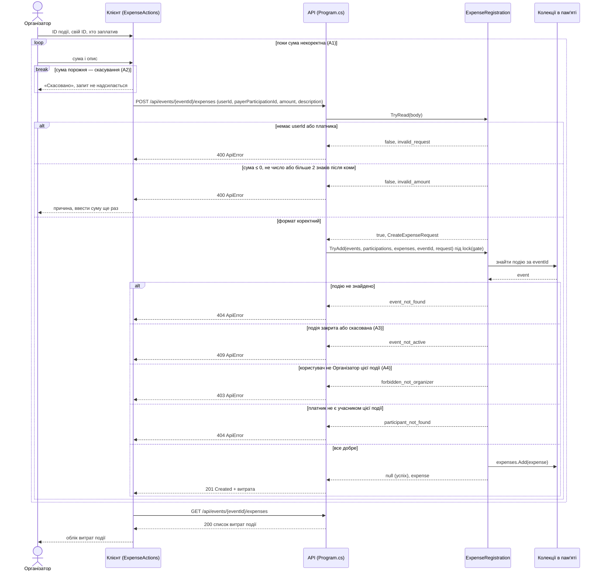

# Діаграма послідовності UC-05 «Зареєструвати витрату»

Автор: Анастасія Халаминдик (@ansstassya)

Діаграма зроблена за кодом v1.0. Клієнт — `ExpenseActions.RunAsync` (src/EventOrganizer.Client/ExpenseActions.cs), веб-сторінка `Pages/Index` (`OnPostAddExpenseAsync`) надсилає такий самий запит. Сервер — маршрут `POST /api/events/{eventId}/expenses` у Program.cs і клас `ExpenseRegistration` (src/EventOrganizer.Api/Infrastructure/ExpenseRegistration.cs). Колекції `events`, `participations`, `expenses` — списки в пам'яті сервера.

У гілках з відмовою немає виклику `expenses.Add`, тому облік події не змінюється. Останній GET клієнт робить, щоб показати, що витрата з'явилась (AC-09) або що після відмови список такий самий (AC-10, AC-15). Після скасування (A2) клієнт нічого не надсилає і завершує дію без GET.
