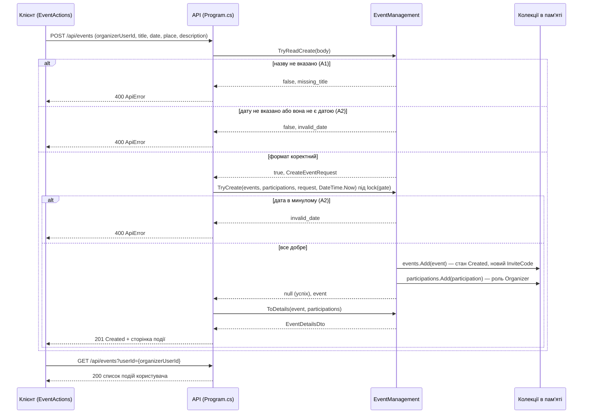

# Діаграма послідовності UC-07 «Створити подію»

Автор: Іван Мороз (@Fidloc)

Діаграма зроблена за фактичним кодом v1.0: клієнт — `EventActions.RunAsync` (src/EventOrganizer.Client/EventActions.cs), сервер — маршрут `POST /api/events` у Program.cs і клас `EventManagement` (src/EventOrganizer.Api/Infrastructure/EventManagement.cs). Колекції `events` і `participations` — це списки в пам'яті сервера, а не окремий клас сховища.

У гілках з відмовою немає викликів `events.Add` і `participations.Add`, тому список подій не змінюється. Останній GET клієнт робить, щоб показати, що подія з'явилась у списку (AC-03) або що після відмови список такий самий, як був (AC-04).

## Відповідність коду

| Повідомлення на діаграмі | Де в коді |
|---|---|
| POST /api/events | `app.MapPost("/api/events", ...)` у Program.cs |
| TryReadCreate | `EventManagement.TryReadCreate` — перевірка назви, потім дати |
| TryCreate під lock(gate) | `EventManagement.TryCreate` — дата в минулому, `events.Add`, `participations.Add` |
| ToDetails | `EventManagement.ToDetails` — подія разом зі списком учасників |
| GET /api/events?userId= | `app.MapGet("/api/events", ...)` у Program.cs |
