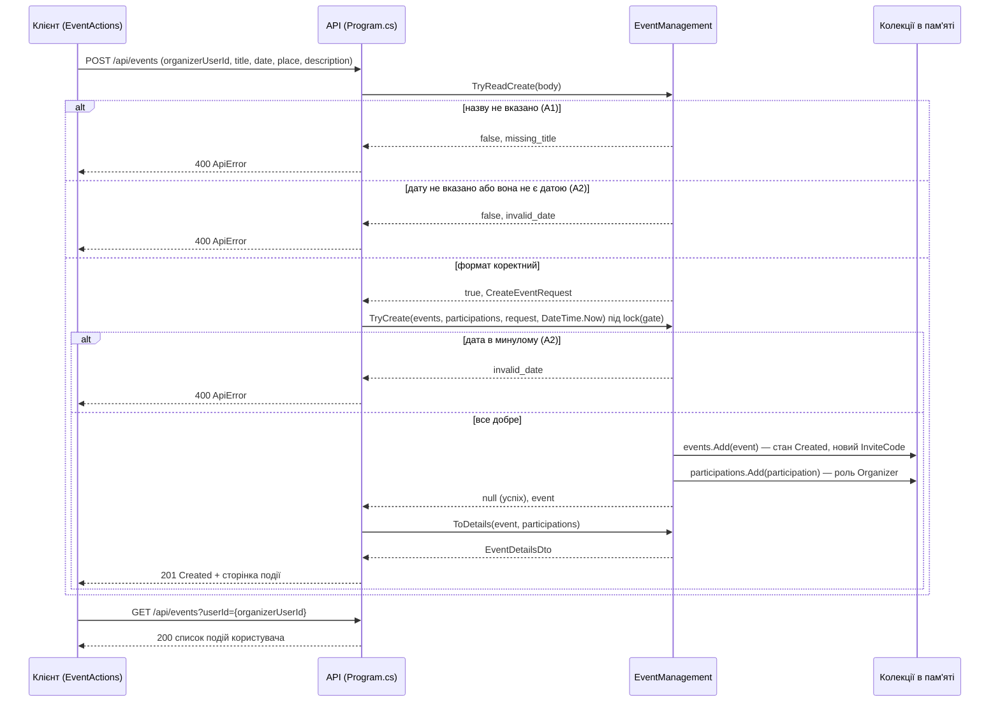

# Діаграма послідовності UC-07 «Створити подію»

Автор: Іван Мороз (@Fidloc)

Діаграма v1.0: 
Клієнт — `EventActions.RunAsync` (src/EventOrganizer.Client/EventActions.cs)
Сервер — маршрут `POST /api/events` у Program.cs 
Клас `EventManagement` (src/EventOrganizer.Api/Infrastructure/EventManagement.cs)
Колекції `events`, `participations` списки в пам'яті сервера

## Відповідність

| Повідомлення на діаграмі | В коді |
|---|---|
| POST /api/events | `app.MapPost("/api/events", ...)` у Program.cs |
| TryReadCreate | `EventManagement.TryReadCreate` — перевірка назви, потім дати |
| TryCreate під lock(gate) | `EventManagement.TryCreate` — дата в минулому, `events.Add`, `participations.Add` |
| ToDetails | `EventManagement.ToDetails` — подія разом зі списком учасників |
| GET /api/events?userId= | `app.MapGet("/api/events", ...)` у Program.cs |
