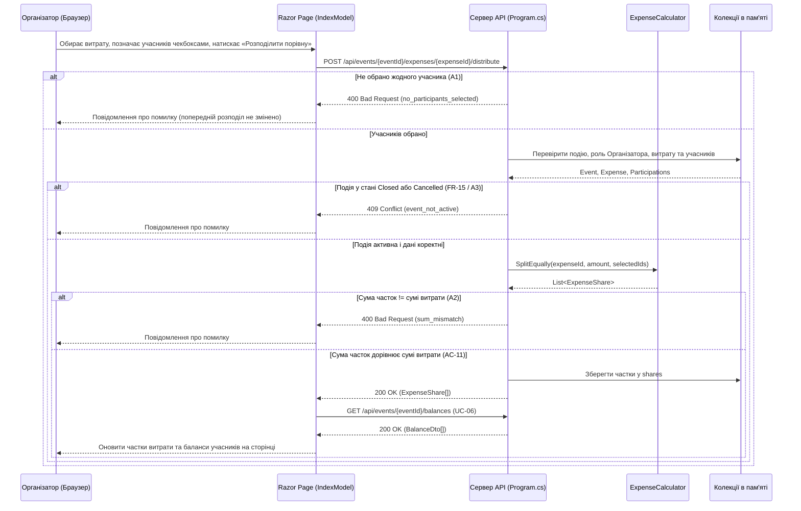

# Діаграма послідовності UC-09 «Розподілити витрату»

Діаграма де клієнтська частина — Razor Page `Pages/Index.cshtml` (`IndexModel.OnPostDistributeAsync`), серверна частина — маршрут `POST /api/events/{eventId}/expenses/{expenseId}/distribute` у `Program.cs` та розрахунковий клас `ExpenseCalculator` (`src/EventOrganizer.Api/Infrastructure/ExpenseCalculator.cs`).

