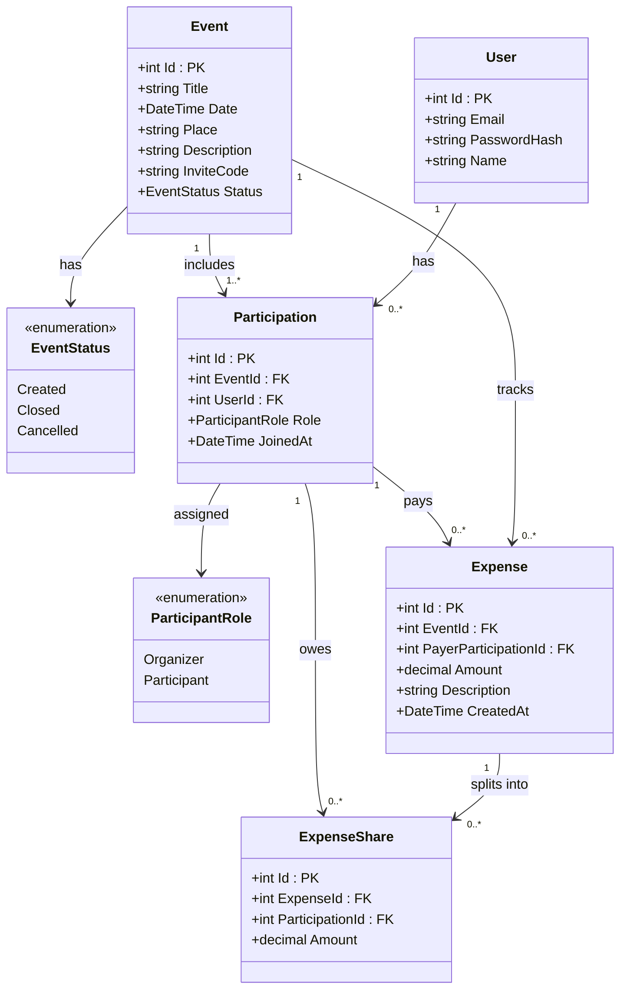

# Діаграма класів збережуваних даних (Relational Data Model v1.1 — Sprint 1)

Ця діаграма описує об'єктно-реляційну модель даних Entity Framework Core для SQLite у Спринті 1, включаючи атрибути, первинні ключі, зовнішні ключі та кратності зв'язків.

## Кратність та зв'язки таблиць
* **User (1) &rarr; Participation (0..\*):** один користувач може брати участь у багатьох подіях.
* **Event (1) &rarr; Participation (1..\*):** кожна подія має щонайменше одного учасника (Організатора).
* **Event (1) &rarr; Expense (0..\*):** подія може містити нуль або більше витрат.
* **Participation (1) &rarr; Expense (0..\*):** конкретний учасник може бути платником кількох витрат.
* **Expense (1) &rarr; ExpenseShare (0..\*):** після реєстрації (UC-05) витрата ще не має часток; частки з'являються після розподілу (UC-09).
* **Participation (1) &rarr; ExpenseShare (0..\*):** на частку витрати призначається конкретний учасник (`Participation`).

## Як визначається Організатор
У таблиці `Events` немає окремого зовнішнього ключа на організатора. Роль користувача в конкретній події зберігається в `Participation.Role`: Організатор — це учасник із `Role = Organizer`. Тому один користувач може бути Організатором однієї події й Учасником іншої.

Поле `EventStatus` і `ParticipantRole` зберігаються в БД як текст (`HasConversion<string>()` в `AppDbContext`).
